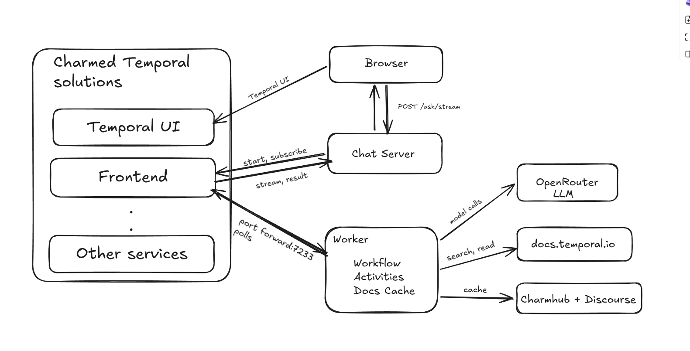
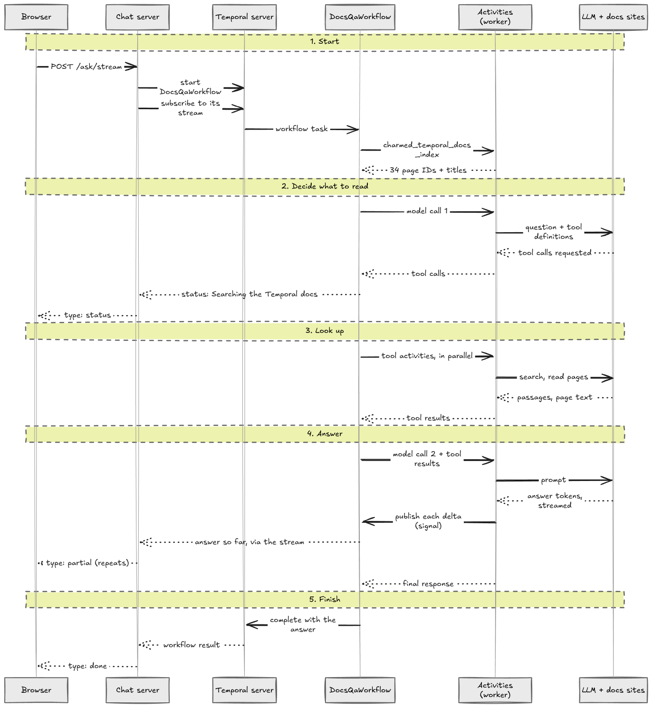

# Charmed Temporal AI Docs Assistant Workshop

This workshop deploys Charmed Temporal and runs a documentation assistant on top
of it: a chat page where every question is answered by a Temporal workflow. The
workflow runs an AI agent (built with the OpenAI Agents SDK) that looks the answer
up in the Temporal and Charmed Temporal documentation with its tools, then writes
an answer that cites its sources. The LLM is reached through
[OpenRouter](https://openrouter.ai) by default, so you can use models from
OpenAI, Anthropic, Google and others with one key.

It follows the patterns in the [Temporal AI Cookbook](https://docs.temporal.io/ai-cookbook)
and uses Temporal's [OpenAI Agents SDK integration](https://github.com/temporalio/sdk-python/tree/main/temporalio/contrib/openai_agents):
every LLM call and every tool call is its own activity, so Temporal retries each
one separately and records every step.

Estimated duration: about 45 minutes (15 minutes of deployment, then the exercises).

## Components



| Component | Purpose |
|-----------|---------|
| Temporal frontend, history, matching and worker services | The Temporal server, deployed as four `temporal-k8s` applications |
| Temporal UI | Web UI for inspecting workflow runs |
| Temporal admin | Admin tools; used here to create the Temporal namespace |
| PostgreSQL + PgBouncer | Temporal persistence and visibility databases |
| Docs assistant worker (`app/src/agent_worker.py`, `app/src/docs_tools.py`) | Runs `DocsQaWorkflow`, the model calls and the docs tools, on your machine |
| Chat page (`app/src/chat_ui.py`, `app/src/chat.html`) | Starts one workflow per question and shows the answer |

## Prerequisites

- Canonical Kubernetes with a bootstrapped Juju controller
- `just` (`snap install --classic just`)
- `terraform` CLI (`snap install --classic terraform`)
- `kubectl` and `jq`
- `uv` (`snap install --classic astral-uv`)
- An [OpenRouter API key](https://openrouter.ai/settings/keys) with a little
  credit. Each question costs roughly 0.01 USD with the default model.

### Set your LLM API key

Save the key once, outside the repository, and load it in new terminals:

```bash
mkdir -p ~/.config/secrets
read -s LLM_API_KEY        # paste the key, press Enter
(umask 077; printf 'export LLM_API_KEY=%q\n' "$LLM_API_KEY" > ~/.config/secrets/llm.env)
echo '[ -f ~/.config/secrets/llm.env ] && . ~/.config/secrets/llm.env' >> ~/.bashrc
```

Only the worker needs the key. Never commit it.

To use OpenAI directly instead of OpenRouter, put an OpenAI key in
`LLM_API_KEY` and also set:

```bash
export LLM_BASE_URL="https://api.openai.com/v1"
export LLM_MODEL="gpt-4.1-mini"   # OpenAI model names have no "openai/" prefix
```

Any other OpenAI-compatible API works the same way.

## Quick Start

```bash
# Deploy Charmed Temporal and create the ai-assistant namespace (~15 min)
just deploy

# Terminal 1: forward the Temporal frontend to localhost:7233 (keep it running)
just forward

# Terminal 2: run the worker
just worker

# Terminal 3: run the chat page, then open http://localhost:8080
just chat

# Optional, terminal 4: Temporal UI on http://localhost:8088
just ui

# Tear down
just teardown
```

## Commands

| Command | Description |
|---------|-------------|
| `just deploy` | Create the Juju model, deploy Charmed Temporal, wait for it, create the namespace |
| `just forward` | Forward the Temporal frontend to `localhost:7233` |
| `just worker` | Run the docs assistant worker (needs `LLM_API_KEY`) |
| `just chat` | Run the chat page on `http://localhost:8080` |
| `just ui` | Forward the Temporal UI to `http://localhost:8088` |
| `just status` | Show `juju status` for the model |
| `just teardown` | Destroy the deployment, the model and the Terraform state |

## Exercises

### 1. Ask questions

Start with the suggested questions on the chat page, then try these:

| Question | What to expect |
|----------|----------------|
| What is the difference between a Workflow and an Activity? | "Searching the Temporal docs", then an answer citing docs.temporal.io |
| How do I pass secrets to my worker with the `environment` config option? | "Reading the Charmed Temporal docs", then an answer from the worker's configuration pages |
| How do I write a Workflow that waits for a Signal in Python? | Several searches or page reads before the answer |
| What is the capital of France? | A refusal: the instructions restrict it to Temporal |

### 2. Follow a question through Temporal

1. Run `just ui` and open `http://localhost:8088/namespaces/ai-assistant/workflows`.
2. Each question is one `DocsQaWorkflow` execution with its own Workflow ID.
3. Open one and read its **Event History**. In order, you'll see:
   - the question as input;
   - `charmed_temporal_docs_index`, which loads the list of charm docs pages;
   - an `invoke_model_activity_streaming` activity for each LLM call;
   - an activity for each tool the agent chose, such as `search_temporal_docs`;
   - the answer as the result.
4. The `__temporal_workflow_stream_publish` signals in the history carry the
   answer to the chat page while it is written (see [How It Works](#how-it-works)).

### 3. See durable execution

1. Ask a question and, while it is running, stop the worker with `Ctrl+C`.
2. In the Temporal UI the execution stays **Running** with the activity pending.
3. Start the worker again with `just worker`. The new worker replays the
   workflow's history, so tool calls that already finished are not repeated.
   The interrupted LLM call stopped heartbeating when the worker died, so
   within 30 seconds Temporal retries it on the new worker. The answer then
   starts again from the beginning in the chat page.

The workflow has a 3-minute limit, so restart the worker promptly.

### 4. See a failure that is not retried

Stop the worker, start it again with an invalid key
(`LLM_API_KEY=invalid just worker`) and ask a question. The chat page shows
"The LLM API rejected the key" within a few seconds, and in the Temporal UI the
`invoke_model_activity_streaming` activity failed once and was not retried.

Temporal retries failed activities by default, which is right for rate limits
or a provider outage. Retrying a wrong key cannot succeed, so Temporal's OpenAI
Agents integration marks client errors such as 401 as non-retryable, and the
chat page explains them using `LLM_ERROR_HINTS` in `agent_worker.py`, followed by
the API's own explanation ("The API said: …"). This is the
same idea as the cookbook's "Retry policy from HTTP responses" recipe. Restart
the worker with your real key afterwards.

### 5. Compare models

Restart the worker with a different model and ask the same question again:

```bash
LLM_MODEL=anthropic/claude-haiku-4.5 just worker
LLM_MODEL=google/gemini-2.5-flash just worker
```

Compare the answers and the time shown under each one. Only the setting changes;
the code is the same for every model. Browse
[OpenRouter's model list](https://openrouter.ai/models) for names. Models marked
`:free` cost nothing but are rate-limited, which shows up as Temporal retrying
the activity.

## How It Works



1. **Terraform** deploys the charmed-temporal-solutions module into the
   `temporal-workshop` model, sized for a single node.
2. The **justfile** creates the `ai-assistant` Temporal namespace through the
   `temporal-admin` charm's `cli` action.
3. The **chat page** starts a `DocsQaWorkflow` execution for each question
   (Workflow ID `docs-qa-<uuid>`).
4. The **worker** runs the workflow. The workflow gets the list of Charmed
   Temporal docs pages, then runs the agent. Temporal's OpenAI Agents
   integration turns each step of the agent into an activity:
   - each LLM call is an `invoke_model_activity_streaming` activity;
   - each tool call is an activity of the same name.
5. The agent has three tools, in `docs_tools.py`:

   | Tool | Source |
   |------|--------|
   | `search_temporal_docs` | Temporal's public [docs search endpoint](https://docs.temporal.io/llms.txt), which returns the most relevant passages from docs.temporal.io, learn.temporal.io and the Temporal blog |
   | `read_temporal_docs_page` | A whole docs.temporal.io page, as Markdown |
   | `read_charmed_temporal_docs` | A page of the [Charmed Temporal documentation](https://charmhub.io/temporal-k8s/docs), or a charm's configuration or action reference on Charmhub |

   The worker downloads the Charmed Temporal pages when it starts and keeps
   them fresh in the background, so reading them is instant.
6. The answer is streamed to the page through
   [Workflow Streams](https://docs.temporal.io/develop/python/workflows/workflow-streams)
   (in public preview): the LLM activity publishes the model's output to the
   workflow, the workflow publishes a status event for each tool call, and the
   chat server subscribes to both. The complete answer is the workflow's result.

The LLM and tool calls happen only in activities, never in workflow code,
because workflow code must be deterministic. Each question is a separate
workflow, so the assistant does not remember earlier questions.

## Configuration

The worker and chat page read these environment variables. The justfile sets
the Temporal ones for you.

| Variable | Default | Used by | Purpose |
|----------|---------|---------|---------|
| `TEMPORAL_HOST` | `localhost:7233` | worker, chat | Temporal frontend address |
| `TEMPORAL_NAMESPACE` | `ai-assistant` | worker, chat | Temporal namespace |
| `TEMPORAL_TASK_QUEUE` | `ai-docs-queue` | worker, chat | Task queue the worker polls |
| `LLM_API_KEY` | none (required) | worker | API key for the LLM provider |
| `LLM_BASE_URL` | `https://openrouter.ai/api/v1` | worker | OpenAI-compatible API to send requests to |
| `LLM_MODEL` | `openai/gpt-4.1-mini` | worker | Model used for answers, in the provider's naming |
| `DOCS_CACHE_TTL` | `600` | worker | Seconds before fetched pages are downloaded again |
| `DOCS_MAX_CHARS` | `20000` | worker | Maximum characters of one page sent to the model |
| `TEMPORAL_UI_URL` | `http://localhost:8088` (via `just chat`) | chat | Adds an "Open Temporal UI" link to the page |

## Limitations

- Questions are sent to Temporal's public docs search endpoint, so don't ask
  about anything confidential.
- The sources are fixed: Temporal's public documentation and the Charmed
  Temporal docs on Charmhub. Internal content such as runbooks or design docs
  has no public search, so it would need its own index, for example PostgreSQL
  with the pgvector plugin, which `postgresql-k8s` supports.
- Questions are independent; there is no conversation memory.
- Workflow Streams and the integration's streaming support are experimental
  and may change in future Temporal SDK releases.

## Troubleshooting

| Symptom | Cause and fix |
|---------|---------------|
| Temporal units show `error` during `just deploy` | A known race while the database schema is created (canonical/temporal-k8s-operator#133). The model retries failed hooks, so they recover on their own. |
| Chat page says it could not reach Temporal | `just forward` is not running, or `TEMPORAL_HOST` is wrong. |
| An answer never arrives and the page suggests checking the worker | The worker is not running, or is polling a different namespace or task queue. |
| Worker exits with "LLM_API_KEY is not set" | Set the key; see "Set your LLM API key". |
| Chat page says the LLM API rejected the key (HTTP 401) | `LLM_API_KEY` is wrong, or is a key for a different provider than `LLM_BASE_URL`. |
| Chat page says the account has run out of credit (HTTP 402) | Add credit to your OpenRouter account, or switch to a `:free` model. |
| Chat page says the API does not know this model (HTTP 404) | `LLM_MODEL` is misspelt or in the wrong format: OpenRouter uses `openai/gpt-4.1-mini`, OpenAI uses `gpt-4.1-mini`. |
| Chat page says the LLM API rejected the request (HTTP 400) | Read the "The API said" part: the model does not accept something in the request, such as a setting or tool calling. Try another `LLM_MODEL`. |
| Answers are slow and the activity shows several attempts | The provider is rate-limiting you (HTTP 429), common with `:free` models. Temporal keeps retrying until the workflow's 3-minute limit. |
| Worker fails with `RestrictedWorkflowAccessError` | A library used only by activities was imported without `workflow.unsafe.imports_passed_through()`. Keep such imports inside that block in `agent_worker.py`. |

## File Structure

```
ai-docs-assistant/
├── justfile          # Deployment and demo automation
├── README.md
├── docs/
│   ├── architecture.png   # Architecture diagram
│   └── question-flow.png  # The path of one question
├── app/
│   ├── pyproject.toml
│   ├── uv.lock
│   └── src/
│       ├── agent_worker.py   # DocsQaWorkflow, the agent, and the worker
│       ├── docs_tools.py     # The agent's docs tools, each a Temporal activity
│       ├── chat_ui.py        # FastAPI server for the chat page
│       └── chat.html         # Chat page
└── terraform/
    ├── main.tf       # charmed-temporal-solutions module, sized for one node
    ├── variables.tf
    └── terraform.tf
```
